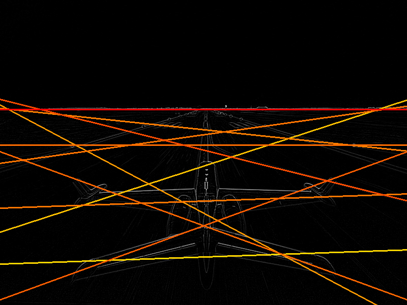
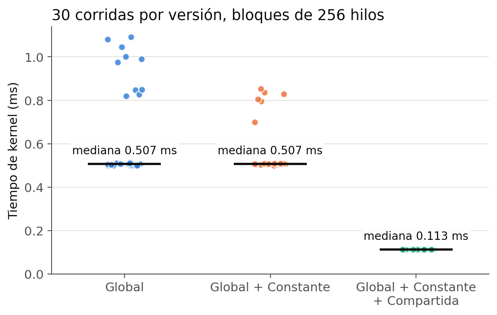
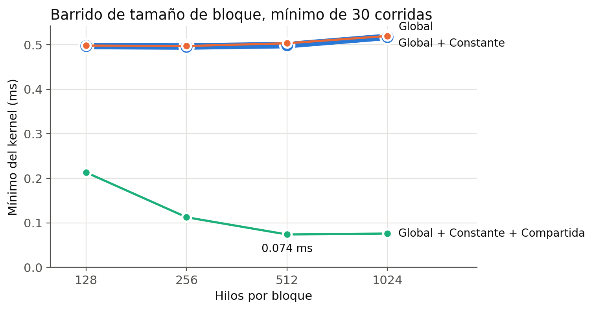

# Proyecto 3: Transformada de Hough en CUDA

Detección de líneas rectas con la Transformada lineal de Hough en GPU, en tres versiones: memoria **Global**, **Global + Constante** y **Global + Constante + Compartida**.
Computación Paralela y Distribuida, UVG.



## Resultados

NVIDIA GeForce RTX 5070 Ti, CUDA 12.8, bloques de 256 hilos, 30 corridas intercaladas por versión ([bitácoras](results/)):

| Versión | Mediana | Media ± sd | Speedup vs global | Speedup vs CPU |
|---|---|---|---|---|
| Global | 0.507 ms | 0.653 ± 0.223 ms | 1.00× | 64× |
| Global + Constante | 0.507 ms | 0.565 ± 0.123 ms | 1.00× | 64× |
| **Global + Constante + Compartida** | **0.113 ms** | 0.113 ± 0.000 ms | **4.49×** | **288×** |

- Con **bloques de 512** la versión compartida baja a **0.074 ms** (6.8× vs global).
- Las versiones global y constante tienen saltos aleatorios de hasta 1.1 ms. Un [control de 600 corridas](results/bitacora_control_ruido.csv) muestra que le pasa a cualquier kernel de más de 0.4 ms, así que es interferencia externa; por eso se reportan mediana y mínimo (con mínimos el speedup es 4.40×).
- Las tres versiones dan **0 diferencias** contra la CPU y generan el mismo acumulador e imagen ([compare_outputs](results/compare_outputs.txt)).
- La memoria constante **no mejora** el tiempo (Welch p = 0.065). El experimento [`variants.cu`](src/experiments/variants.cu) muestra por qué: leer cos/sin nunca fue el cuello de botella, la contención de `atomicAdd` sí.
- [`optimizaciones.cu`](src/experiments/optimizaciones.cu) prueba tres mejoras sobre la versión compartida. Ninguna gana: desfasar θ por hilo la hace 1.8× más lenta (y 4.4× con memoria constante, que se serializa con accesos divergentes), y varios píxeles por hilo con reparto fijo la hace 1.5× más lenta por desbalance de carga.

| Tiempos por versión | Barrido de bloques |
|---|---|
|  |  |

Informe completo: [Informe_Proyecto3_Paralela.pdf](Informe_Proyecto3_Paralela.pdf).

## Compilar y ejecutar

Requiere CUDA 12.x y `make`. Python 3 con `numpy pandas scipy matplotlib pillow` para el análisis.

```bash
make                                  # hough_global, hough_const, hough_shared
./hough_shared runway.pgm --runs 30   # tiempos, validación e imágenes en output/
make run                              # las 3 versiones + comparación
```

| Opción | Default | Descripción |
|---|---|---|
| `--runs N` | 10 | corridas medidas del kernel (más una de calentamiento) |
| `--block B` | 256 | hilos por bloque |
| `--k K` | 2.0 | umbral de líneas = media + K por sd de los votos |
| `--top N` | 0 (todas) | dibujar solo las N líneas más fuertes |
| `--nms 0/1` | 1 | máximo local 5×5 (circular en θ) |
| `--csv f` | — | agrega las mediciones a un CSV |
| `--out p` | `output/runway` | prefijo de las imágenes |

### Benchmarks y análisis

```bash
bash scripts/run_benchmarks.sh 3 10   # 3 versiones intercaladas (3 rondas × 10) + variants + optimizaciones
bash scripts/block_sweep.sh 30        # 128, 256, 512 y 1024 hilos por bloque
python scripts/compare_outputs.py     # verifica que las 3 versiones coinciden
python scripts/analyze.py             # results/summary.*
python scripts/plots.py               # results/figures/
```

### Windows con Docker

```powershell
docker run --rm --gpus all -v "${PWD}:/work" -w /work nvidia/cuda:12.8.1-devel-ubuntu22.04 bash -c "make && bash scripts/run_benchmarks.sh"
```

La imagen no trae Python: `compare_outputs`, `analyze` y `plots` se corren en el host.

## Cómo funciona

1. Un hilo por píxel: `gloID = blockIdx.x * blockDim.x + threadIdx.x`. Las coordenadas se centran en la imagen.
2. Cada píxel encendido vota por 90 ángulos en un acumulador de 90×100 bins con `atomicAdd`.
3. **Constante:** `d_Cos`/`d_Sin` en `__constant__`, cargadas con `cudaMemcpyToSymbol`; todo el warp lee el mismo valor (broadcast).
4. **Compartida:** cada bloque vota en `localAcc` (36 KB de `__shared__`). Barrera 1 tras inicializar, barrera 2 tras votar, y volcado al acumulador global solo de los bins con votos.
5. CPU y GPU usan la misma fórmula (`rIndex` con `fmaf`), así que el resultado es idéntico bin por bin.
6. Se dibujan los bins con votos > media + K por sd que además son máximos locales 5×5.

## Estilo de documentación

Comentarios cortos que empiezan con una etiqueta, iguales en las tres versiones. Buscar una etiqueta lleva a la misma etapa en cada archivo.

| Etiqueta | Marca |
|---|---|
| `[ID]` | índices del hilo (`gloID`, `locID`) |
| `[COORD]` | coordenadas centradas |
| `[ATOMIC]` | sumas atómicas |
| `[CONST]` | memoria constante |
| `[SHARED]` | memoria compartida |
| `[BARRERA 1]`, `[BARRERA 2]` | `__syncthreads()` |
| `[VOLCADO]` | suma del acumulador local al global |
| `[HOST]`, `[GPU]`, `[TIEMPO]`, `[SALIDA]`, `[LIMPIEZA]` | etapas del `main` |

## Estructura

```
src/hough_global.cu          memoria global
src/hough_const.cu           global + constante
src/hough_shared.cu          global + constante + compartida (versión final)
src/experiments/variants.cu  pregunta 7a (acceso a cos/sin) y variantes del volcado
src/experiments/optimizaciones.cu  optimizaciones probadas sobre la versión compartida
common/                      host compartido: PGM, CPU, validación, tiempos, líneas, PNG
scripts/                     benchmarks, barrido, análisis, gráficas, comparación
results/                     bitácoras CSV, resúmenes, figuras
output/                      imágenes de salida y acumuladores (.bin)
Informe_Proyecto3_Paralela.pdf  informe completo
third_party/                 stb_image_write (dominio público)
```
