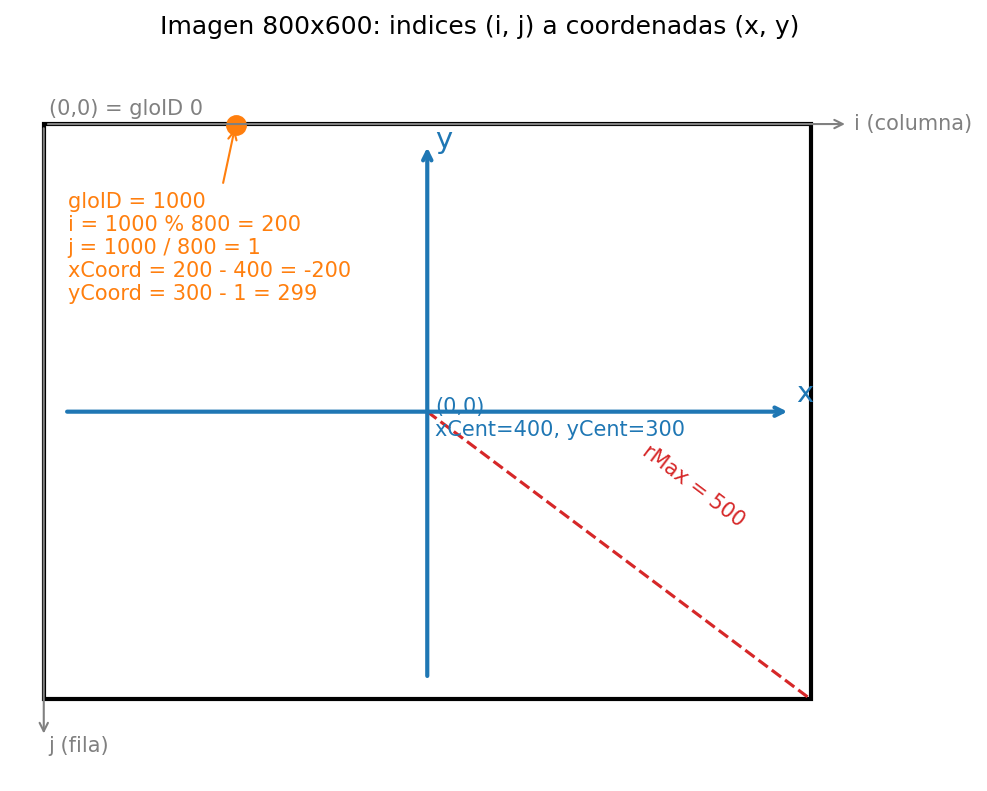

# Tarea 3: xCoord y yCoord

Cada hilo procesa un pixel y `gloID` es su posición en la imagen guardada fila por fila (ancho `w`). Para recuperar la posición 2D:

- `gloID % w` es la columna `i` (cuántos pixeles lleva en su fila).
- `gloID / w` es la fila `j` (cuántas filas completas hay antes).

La Transformada de Hough asume el origen en el centro de la imagen (Figura 2 del enunciado), así que se desplazan las coordenadas:

- `xCoord = i - xCent`: la columna se mide desde el centro. Es negativa a la izquierda y positiva a la derecha.
- `yCoord = yCent - j`: en una imagen la fila 0 está arriba y `j` crece hacia abajo, mientras que en el plano cartesiano `y` crece hacia arriba. Por eso se invierte el eje: `yCent - j` es positivo arriba del centro y negativo abajo.

Con el origen en el centro, `r = xCoord·cos(θ) + yCoord·sin(θ)` queda en `[-rMax, rMax]`, donde `rMax` es la distancia del centro a una esquina. Al sumar `rMax` y dividir entre `rScale` se obtiene `rIdx` en `[0, rBins)`.

Si el origen estuviera en una esquina, `r` iría de `-diagonal` a `+diagonal` y con los mismos 100 bins cada bin cubriría el doble de distancia, así que se perdería precisión.

## Ejemplo con `runway.pgm`

En una imagen de 800×600 se tiene `xCent = 400`, `yCent = 300` y `rMax = √(800² + 600²) / 2 = 500`. El hilo `gloID = 1000` procesa:

| Paso | Cálculo | Resultado |
|---|---|---|
| Columna | `1000 % 800` | `i = 200` |
| Fila | `1000 / 800` | `j = 1` |
| x centrada | `200 - 400` | `xCoord = -200` (izquierda del centro) |
| y centrada | `300 - 1` | `yCoord = 299` (casi en el borde superior) |

## ¿Por qué `atomicAdd` si hay un hilo por píxel?

Cada hilo lee un píxel distinto, así que en la imagen no hay carrera. La carrera ocurre en el acumulador: todos los píxeles de una misma recta votan por el mismo bin `(rIdx, tIdx)`. Si dos hilos hacen `acc[k]++` al mismo tiempo, ambos pueden leer el mismo valor y uno de los votos se pierde. `atomicAdd` hace la lectura, la suma y la escritura como una sola operación.
